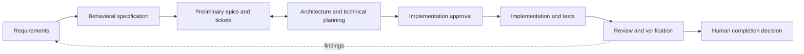

# Architecture

Beligent SDD separates product decisions from engineering execution. It borrows
durable artifacts and adjustable process depth from
[Spec Kit](https://github.com/github/spec-kit) and
[BMAD](https://github.com/bmad-code-org/BMAD-METHOD), using the
[Agent Skills standard](https://agentskills.io/specification) for portable
procedures rather than importing their runtime or persona systems.

| Layer | Canonical resources | Responsibility |
| --- | --- | --- |
| Management | `define-work` workflows, templates and provider contract | Define what/why and manage requirements, behavior, epics and tickets |
| Engineering | `plan-work`, `implement-ticket`, `verify-work` | Plan, implement, review and verify approved behavior |
| Technology | `implement-ticket/references/technology/` | Select only relevant stack guidance |
| Integration | Setup assets and assistant discovery documentation | Load shared instructions and portable skills |

Setup is handled by `init-project` and `adopt-project`, bringing the core total
to six skills. Within management, `requirements`, `specification`, `epics` and
`tickets` are direct workflow selectors, each with its own inputs and outputs.
No full lifecycle run is required to invoke one.



This is a common path, not a mandatory sequence. Preliminary tickets may start
before detailed specifications or architecture. Planning refines them through
the same provider contract. Engineering links to management artifacts instead
of maintaining another requirements copy.

For schema 2, ordinary work follows a bounded manual composition:

```text
define-work → plan-work when useful → implement-ticket → verify-work
```

The [current-task lifecycle](../skills/define-work/references/shared/current-task-lifecycle.md)
defines shared routing, context inheritance, depth expansion, drift handling,
and verification selection. It is authored once and packaged into the four
lifecycle skills. Schema 1 retains the expanded profile-based behavior above.
Project and epic planning remain available through explicit planning modes; an
ordinary task does not imply either.

## Framework and project ownership

Reusable instructions, workflows, templates, guidelines and adapters are versioned
in this repository and installed as skills. The consumer project owns its
`.beligent/config.json`, integration records and management artifacts. Project
overrides live outside installed skills. See the
[configuration template](../skills/init-project/assets/config.json).

The framework release version and configuration schema version are independent.
The installer lock records installed-source provenance. Setup state records only
integration ownership and baselines. [Maintenance](maintenance.md) separates
skill updates, configuration migrations and instruction refreshes.

## Ticket storage boundary

The [provider contract](../skills/define-work/references/ticket-management/contract.md)
defines normalized records and semantic operations. The
[Markdown provider](../skills/define-work/references/ticket-management/markdown.md)
maps them to files. Workflow logic does not depend on those file headings or
locations. A future tracker provider supplies mapping and conflict semantics;
it does not require rewriting product workflows. The MVP has no remote provider,
runtime plugin system or synchronization service.

## Portable packaging

Each installed skill contains its runtime references. A small TypeScript
maintainer helper copies explicitly shared resources from one canonical source.
Generated `PACKAGED.json` manifests identify that source; edit the canonical
file and synchronize, never the copy. Consumers need no build step. Repository
validation rejects drift and escaping skill references.

The optional `sdd` TypeScript CLI provides read-only consumer configuration
validation and diagnostics. JSON Schema describes the stable config shape;
filesystem checks add containment, link, and path-collision validation. The CLI
does not implement setup or adoption workflows. The same TypeScript toolchain
also validates the framework and packages shared assets for maintainers.

Technology guides have one authoring location under `implement-ticket`. Planning
receives packaged copies of the same guides because it must work independently
after installation. It loads only the modules selected by the project.

Human gates are instruction-based working agreements; they are not a technical
security system enforced uniformly across assistants. Actual discovery and
smoke-test evidence is reported in [validation](validation.md).
